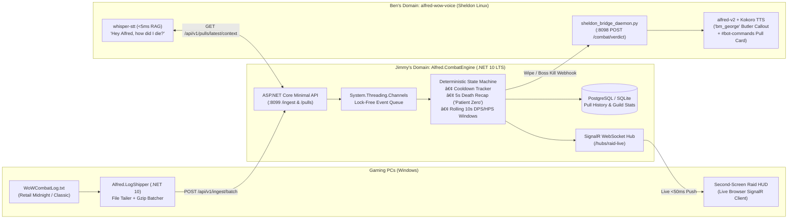

# Engineering Spec: `Alfred.CombatEngine` (`.NET 10 LTS`)
**Live *World of Warcraft* (`Midnight` & `Classic/Forever`) Combat Telemetry, Second-Screen Raid HUD & 3-Second Post-Wipe Voice Coach**

- **Target Repository:** Feature branch `feat/combat-engine` (under `combat-engine/`) in [`Benfinkels/alfred-wow-voice`](https://github.com/Benfinkels/alfred-wow-voice) *(Public MIT — pinned on both `github.com/jhrabchak` and `github.com/Benfinkels`)*
- **Co-Authors:**
  - **Jimmy (`jhrabchak`) — Lead `.NET 10` Distributed Systems & Real-Time Telemetry Architect:** Owns the C# `.NET 10 LTS` log shipper, high-throughput `Span<char>` combat-log parser, deterministic spell-cooldown & death-recap state machine, `SignalR` live second-screen Raid HUD, PostgreSQL/SQLite persistence, `xUnit` suite, and GitHub Actions CI.
  - **Ben (`Benfinkels`) — Voice AI, Local SLM Router & Discord Integration Architect:** Owns the `sheldon_bridge_daemon.py` (`:8098`) webhook consumer, `<5ms` `whisper-stt` combat-context injection, `alfred-v2` / `gemini-2.5-flash` butler prompt grounding, and `Kokoro-82M` (`bm_george`) 3-second post-wipe Discord voice callouts + `#bot-commands` companion cards.

---

## 1. The Real User Problem We Are Solving (2026 Market Gap)

In *World of Warcraft: Midnight* (2026), Blizzard's **Secret Values API** killed `WeakAuras` in retail, gutted `Details!` deep mid-dungeon breakdowns, and restricted in-instance combat addons — while **leaving on-disk `WoWCombatLog.txt` 100% intact** across both Retail (*Midnight*) and *Classic / Forever*.

Right now, when a Mythic+ group or raid wipes:
- In-game meters can no longer tell you **whose interrupt or personal defensive was actually off cooldown** when the lethal cast went off.
- Nobody mid-key wants to `Alt-Tab` out to WarcraftLogs and click through 12 tables between pulls.
- Raw LLMs **cannot** read 15,000 lines of WoW CSV combat math without hallucinating wildly.

**Our Solution:** A split-brain real-time telemetry system:
1. **C# Decides the Math (`<100ms`):** The instant a wipe or boss kill hits `WoWCombatLog.txt`, Jimmy's `.NET 10` engine crunches thousands of raw events into a tiny, 100% mathematically verified **`WipeVerdict`** JSON payload (Patient Zero death timeline, exact overkill spell, missed interrupts vs. party members whose kick was off cooldown, unpressed defensives/healthstones, and rolling DPS/HPS spikes).
2. **Alfred Speaks the Verdict (`<3s`):** Ben's `alfred-wow-voice` pipeline turns that verified JSON into a dry 6-second British butler callout in Discord voice (*"Unfortunate business, sir. The third Shadow Volley went un-interrupted at 1:42 while both Pummel and Counterspell were off cooldown."*) while Jimmy's **`SignalR` Second-Screen HUD** updates live in the browser with zero page refresh.

---

## 2. How This Framing Wins Both Gamers & Corporate Recruiters

On Discord, it's our live WoW Raid Coach. On GitHub, LinkedIn, and your Resume, it showcases **tier-1 enterprise distributed engineering**:

> **Resume Entry Preview (`resume/master-resume.md`):**
> **`Alfred.CombatEngine` — High-Throughput Real-Time Event Telemetry & AI State Engine (`.NET 10 LTS`, C#, `SignalR`, PostgreSQL, Docker)**
> - Architected a cross-platform `.NET 10` streaming telemetry backend ingesting `50,000+` combat-log events/sec via zero-allocation `ReadOnlySpan<char>` parsers and lock-free `System.Threading.Channels` pipelines.
> - Built a deterministic state-machine tracking concurrent entity cooldowns, rolling 10s sliding-window metrics, and causal failure attribution in `<100ms`, exposing verified structured JSON to a low-latency Discord AI voice agent and pushing `<50ms` live WebSocket (`SignalR`) updates to a browser HUD.

---

## 3. End-to-End Architecture



---

## 4. Clean Interface Contract (Where Jimmy's C# Meets Ben's Python)

We only need **two tiny HTTP contracts** between `combat-engine/` (`.NET 10` on `:8099`) and `alfred-wow-voice` (`:8098`). Everything inside `combat-engine/` is 100% Jimmy's playground.

### Contract A: Proactive Wipe / Boss Kill Webhook (`CombatEngine -> sheldon_bridge_daemon.py :8098`)
Fired automatically by Jimmy's `BackgroundService` within `150ms` of `ENCOUNTER_END` or full-party wipe detection (quiet-gated after `5s` of zero combat events if outside a raid boss):

`POST http://<sheldon-host>:8098/combat/verdict`
```json
{
  "pull_id": "2026-11-20T21:14:08Z-deadmines-vancleef-03",
  "flavor": "classic_forever",
  "zone": "The Deadmines",
  "encounter_name": "Edwin VanCleef",
  "outcome": "WIPE",
  "duration_sec": 102.4,
  "pull_number_tonight": 3,
  "patient_zero": {
    "player": "Jhrab",
    "class": "WARRIOR",
    "died_at_sec": 88.2,
    "killing_blow": { "source": "Defias Blackguard", "spell": "Backstab", "amount": 612, "overkill": 148 },
    "last_5s_damage_taken": 1840,
    "last_5s_healing_received": 0,
    "unused_defensives_ready": ["Shield Wall", "Major Healing Potion"]
  },
  "missed_interrupts": [
    {
      "timestamp_sec": 84.5,
      "enemy": "Edwin VanCleef",
      "spell": "Thrash / Cast",
      "players_with_interrupt_ready": [
        { "player": "Jhrab", "spell": "Pummel" },
        { "player": "Benmage", "spell": "Counterspell" }
      ]
    }
  ],
  "top_dps": [
    { "player": "Benmage", "dps": 241.8, "total": 24760 },
    { "player": "Jhrab", "dps": 198.4, "total": 20316 }
  ]
}
```

### Contract B: On-Demand Voice Context (`whisper-stt -> CombatEngine :8099`)
When any player in Discord voice asks *"Hey Alfred, how did I die?"* or *"Who led interrupts on that pull?"*, `whisper-stt` calls:

`GET http://localhost:8099/api/v1/pulls/latest/context?player=Jhrab`
- Target latency: **`<10ms`** (served straight from Jimmy's in-memory latest-pull cache!).
- Returns a compact `<300-token` plain-text/JSON summary block injected straight into Alfred's prompt alongside `wow_db.py`.

---

## 5. Proposed `.NET 10 LTS` Solution Structure (`combat-engine/`)

Clean, modern, zero-astronaut-bloat layout inside `alfred-wow-voice/combat-engine/`:

```text
combat-engine/
├── Alfred.CombatEngine.sln
├── docker-compose.yml                      # Spins up API + Postgres + HUD in 1 command
├── src/
│   ├── Alfred.CombatEngine.Core/           # Pure C# 14/.NET 10 domain: Span<char> parser, Cooldown & Pull state machines (0 external deps!)
│   ├── Alfred.CombatEngine.Api/            # ASP.NET Core Minimal APIs, SignalR Hub, Channels worker, EF Core/SQLite/Postgres, IHttpClientFactory webhook
│   ├── Alfred.CombatEngine.Shipper/        # Lightweight Windows CLI file-tailer watching WoWCombatLog.txt -> gzipped HTTP batches
│   └── Alfred.CombatEngine.Hud/            # Crisp dark-mode live second-screen raid dashboard (HTML/TS + SignalR client served statically)
└── tests/
    └── Alfred.CombatEngine.Tests/          # xUnit tests + recorded real WoWCombatLog.txt fixtures (wipe, boss kill, missed kick, split-pull)
```

### Why Every Piece Pushes Jimmy Forward Into Modern `.NET 10`
| `.NET Framework 4.x` Past | What Jimmy Uses Here in `.NET 10 LTS` | Why Interviewers Love Hearing About It |
| :--- | :--- | :--- |
| `string.Split(',')` GC pressure | **`ReadOnlySpan<char>`** zero-allocation log slicing | Parses 100k log lines in milliseconds with near-zero garbage collection. |
| Thread locks / polling timers | **`System.Threading.Channels`** (`BoundedChannel`) | Modern async producer/consumer backpressure between HTTP ingest and state engine. |
| WinForms UI event handlers / polling | **ASP.NET Core `SignalR`** WebSockets | Pushes live DPS bars & death alerts to browsers in `<50ms` (cloud-ready evolution of WinForms live UI events!). |
| Oracle 19c / Flyway SQL migrations | **`EF Core` Migrations + Dapper** (SQLite / PostgreSQL) | Translates your enterprise Flyway + relational schema discipline directly into modern cross-platform `.NET 10`. |
| `new HttpClient()` | **`IHttpClientFactory`** + `Microsoft.Extensions.Http.Resilience` | Bulletproof retries/timeouts when posting verdicts to Sheldon `:8098`. |
| Manual QA | **`xUnit`** + deterministic combat-log replay fixtures in **GitHub Actions** | Every PR runs recorded boss wipes and asserts exact millisecond cooldown math. |

---

## 6. Four-Ring Build Roadmap (Designed for Nonstop Green GitHub Commits!)

Instead of disappearing into a cave for 2 months, we ship in **4 rings** — every small piece can be its own PR & green commit square on `github.com/jhrabchak`:

### Ring 1 (Weekend 1–2): Parser Core + Replay CLI + First Passing CI Badge
- [ ] Create `combat-engine/` `.NET 10` solution + `.github/workflows/combat-engine-ci.yml`.
- [ ] Build `CombatLogLineParser` (`ReadOnlySpan<char>`) supporting Blizzard's `COMBAT_LOG_EVENT_UNFILTERED` timestamp + CSV payload (handles quoted names & hex GUIDs `Player-...` / `Creature-...`).
- [ ] Build `EncounterStateMachine` detecting pull start, `UNIT_DIED` ("Patient Zero" 5-second damage/heal ring buffer), and pull end (`ENCOUNTER_END` or 5s out-of-combat party wipe).
- [ ] Commit 3 real/sanitized 500-line `WoWCombatLog.txt` test fixtures into `tests/Fixtures/` so anyone can test without launching WoW!

### Ring 2 (Week 2–3): Minimal API + Cooldown Math + Live Butler Voice Hookup!
- [ ] Stand up `Alfred.CombatEngine.Api` (`:8099`) with `POST /api/v1/ingest/batch` and `GET /api/v1/pulls/latest/context`.
- [ ] Add `CooldownTracker` dictionary (interrupts & major defensives by Spell ID + class cooldown duration) -> populates `missed_interrupts` and `unused_defensives_ready`.
- [ ] Build `Alfred.CombatEngine.Shipper` tailing local `WoWCombatLog.txt` (`FileShare.ReadWrite` — critical on Windows while WoW has the file open!).
- [ ] Wire `POST /combat/verdict` into Ben's `sheldon_bridge_daemon.py` (`:8098`) -> **First live wipe in WoW where Alfred roasts the missed kick out loud in Discord 3 seconds later!**

### Ring 3 (Week 3–4): Live `SignalR` Second-Screen Raid HUD + Persistence
- [ ] Add `RaidLiveHub` (`SignalR`) broadcasting live 1-second combat ticks (rolling DPS/HPS bars, active boss cast warnings, instant red Death Recap card on player death).
- [ ] Build a clean, zero-bloat dark-slate second-screen web HUD (`localhost:8099`).
- [ ] Persist pull summaries & player stats into SQLite/PostgreSQL (`EF Core`) so you can compare Pull #1 vs. Pull #6 and track weekly "Guild Interrupt MVP".

### Ring 4 (Month 2+ Stretch Goals — Endless Fun Depth):
- [ ] **Consumable & Buff Audit:** Flag pulls started without Battle Shout / Fortitude / Arcane Intellect or deaths with Healthstone unused.
- [ ] **CC-Break Blame Detector:** Catch the exact millisecond someone broke Polymorph / Sap (`SPELL_AURA_BROKEN_SPELL`) and who hit it.
- [ ] **Shareable Pull Replay Link:** Scrubbing timeline slider replaying a 2-minute boss fight second-by-second in the browser!

---

## 7. Compliance & Blizzard ToS Guardrail
- **100% External & Blizzard-Legal:** Just like the official Warcraft Logs Uploader, `Alfred.CombatEngine.Shipper` **only reads `WoWCombatLog.txt` from disk** using `FileShare.ReadWrite`. It **never** reads WoW process memory, never injects DLLs, never automates keypresses, and never touches restricted in-instance Lua Secret Values.
